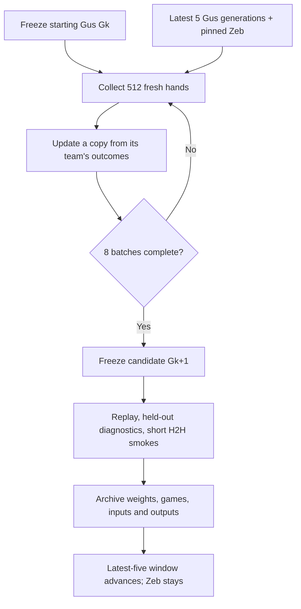

## Decision and implementation boundary

Jason named the current tiny GPT **[[gus-tiny-gpt|Gus]]**, selected the last
five checkpoints as its active population and required Zeb to stay in the loop
(2026-10-18). Earlier instructions retain the clean input boundary and limit
immediate H2H to smokes. This page records the iteration settings. The collector, policy-only PPO,
checkpoint retention and growth orchestration are implemented in `lem/observer/`.
Jason authorized execution to a plateau and depth growth through 709k–800k;
[[gus-population-depth-2026-10-18]] registers the stopping rule and tracks results
(#213). Tracks #178, #182, #203; publication heads-up #212.

“Generation” here means one frozen result of a complete reward iteration, not
one optimizer step or intermediate formation snapshot. `G0` is the published
500k-deal pretrained model, release `pretrained-v0`.

## Population and retention

- The active Gus pool is the most recent **five completed, valid generations**;
  begin with G0 alone and grow naturally. Do not duplicate one model to fill
  five slots. The previous 50k experiment remains a measuring stick, not a
  manufactured reward generation.
- Keep **one permanently pinned Zeb** outside that five-model limit. The
  initial pin is the pip-play configuration and field hash already verified
  in [[lem-nanogpt-foundations]]' Zeb smoke. Replacing it creates a separately
  named population revision; it does not silently move the reference.
- Implemented sampling: each of the other three seats independently receives
  **25% Zeb, 75% a uniform draw from the active Gus pool**, with replacement.
  The learner occupies one seat, rotated evenly across hands and bidder roles.
  Thus Zeb occurs as partner and either opponent. With five generations each
  receives 15% per frozen seat; with only G0 it receives all 75%.
- Seat assignments, policy bytes, choice mode and seeds are frozen for a hand.
  The population roster stays fixed for the whole iteration. Frozen Gus seats
  use legal argmax; the learner samples from its legal softmax at temperature
  1. Zeb uses the deterministic world/node/seed budget in its pinned spec.
- Five is an **active sampling window**, not an archive deletion rule. Preserve
  G0, the incumbent, every finished generation and intermediate formation
  snapshots with optimizer/RNG state in the research archive. A recent failed
  strength candidate can still be a valid population member; a corrupt or
  illegal policy cannot. Versioned files and hashes identify all participants.
- The incumbent (best supported player) and the latest learner are separate
  pointers. A new generation advances the exploratory trajectory. A smoke
  cannot promote it to “better.” If the incumbent ages out of the recent-five
  pool, retain it as a frozen evaluation reference.

This distribution is the initial experiment, not a claim that five is
optimal or that the resulting population covers human styles. The objective
is explicitly conditional on this partner/opponent distribution. There is no
identity token: Gus can respond to behavior visible within the current hand,
but cannot identify a player or remember earlier hands by an added feature.

## Implemented training round

| Item | Pilot setting |
|---|---|
| Start | G0 weights; fresh optimizer, architecture and tokenizer unchanged |
| Scope | Bid 30, pip declarations, existing `Bid30Bidder` procedure |
| Collection | 8 batches × 512 fresh full hands = **4,096 hands** |
| Rotation | Learner seat and bidder-relative role balanced; freeze assignments before play |
| Exploration | Learner samples legal softmax, temperature 1; save the actual sampling log-probability |
| Reward | +1 when the learner's team makes or sets the contract, −1 otherwise; terminal hand result, discount 1 |
| Update | Clipped PPO policy objective, clip 0.2, four passes over each collected batch, 256 learner decisions/minibatch |
| Advantage | Terminal team reward minus a scalar mean from **previous completed collection batches**; first baseline zero, fixed throughout this batch's update |
| Optimizer | AdamW 0.00003, betas (0.9, 0.95), no weight decay, gradient clip 1.0 |
| Exploration term | Legal-action entropy coefficient 0.01; report entropy separately from reward |
| Step guard | If measured old-to-current action-distribution KL exceeds 0.03 after a pass, skip remaining passes on that batch and record it |
| Saving | Before training and after each collection/update block; complete replay, tensors, optimizer and RNG state |

These are the initial experimental settings, not validated
hyperparameters. The PPO policy component follows
[Schulman et al.](https://arxiv.org/abs/1707.06347); the first pilot uses a simple
terminal-return baseline, **no new critic head**. This will likely have more
variance than a learned value baseline. The existing 28-way tile output remains
unchanged; the previously selected splat head is a separate, still-pending
extension in [[lem-nanogpt-foundations]]. No hidden-information critic or
clairvoyant teacher enters this round.

Only the learner's own chosen actions contribute policy gradients. The old
and updated probabilities are both normalized over the exact same lawful
legal set for that decision. Other seats' actions provide observed history,
not learner training actions. A forced move has probability one and no policy
choice gradient. The team's return has the same sign for bidder and partner,
and the opposite sign for defenders; replayed contract outcomes set it.

Retain held-out next-tile prediction as a diagnostic. Do not add a supervised
auxiliary loss in the first reward pilot; that would introduce another
objective and mixing weight. Sampling creates fresh experience after each
update block. Replaying a fixed winning-action file is not this procedure.

## Verification and the short scoreboard

Before collection, fix independent seed namespaces for training, development
smokes and future selection/final evaluation. Reject physical-deal overlap
against the full 500k source corpus and any reserved evaluation panel. Never
reroll a loss or discard an interrupted/error record without recording why.

Required collector/trainer checks:

- Same clean prefix and legal output under hidden-hand changes, seat rotation,
  singleton/shuffled batch and fresh process; retain the existing 48-test base.
- Reward sign for both partnerships; known policy-gradient direction on a tiny
  controlled game; stored sampling probability equals recomputation; unchanged
  policy has PPO ratio one; forced-action gradient zero.
- Mixed-seat routing really seats the intended model for each call. Each
  participant receives only its own initial hand and public prefix. Replay
  all generated games independently, including legal moves and contract score.
- Resume reproduces sampler/optimizer progression; frozen pool weights cannot
  change; last-five rollover never removes Zeb or deletes archived evidence.

At the end, run **one duplicate pair versus the starting Gus and one versus
Zeb: four games total**, using deterministic legal argmax for the candidate.
A mixed-partner fixture additionally checks routing. These are integration
smokes with no strength interval or promotion claim. Do not silently extend
H2H to a long match. A later actual promotion measurement needs its own fixed
sample size, fresh paired seeds and interval; selection and final reporting
must use different deals. Preserve the pairwise matrix rather than only one
rating, because improvements can cycle.

Zeb's methodology also suggests pricing disagreements against **lawful** stored
teacher values (`regret_q`, all-tie-best `at_best`, decisive-choice slices).
That observer evaluator remains to be built; tile accuracy is not a substitute.
A future splat head needs both teacher-distribution and realized-outcome
calibration under the named continuation population. Current tile logits do
not supply those forecasts.

W&B should show hand count and update block, team return by partner/opponent
composition and bidder role, entropy, KL, clipping fraction, gradient norm,
prediction retention and smoke outcomes. Name each run `gus-gNNN`; record parent,
pool hashes and encoding version. H2H smoke outcomes stay visibly separate
from training return. Publish every generation to the Gus model repo with a
version tag and pin its commit; full trajectories go to the research dataset.
All heavy work uses `scripts/cpu-slot`, bounded by deterministic hand/update
counts; CPU instructions, CPU time and wall time are descriptive.

## Why this iteration

The pretrained network already predicts useful patterns and plays better than
its 50k predecessor in the measured setting ([[lem-observer-first-h2h-2026-10-17]]).
This next experiment changes the learning signal: increase the probability of
choices associated with the team's success, while preserving clean inputs and
native mechanisms for [[clean-neurons-42]]. It does not prove a universal player
ordering, equilibrium, neuron meanings, or the ability to model people across
hands. Sources for population precedent are the OpenAI Five and AlphaStar
references in [[lem-nanogpt-foundations]].
